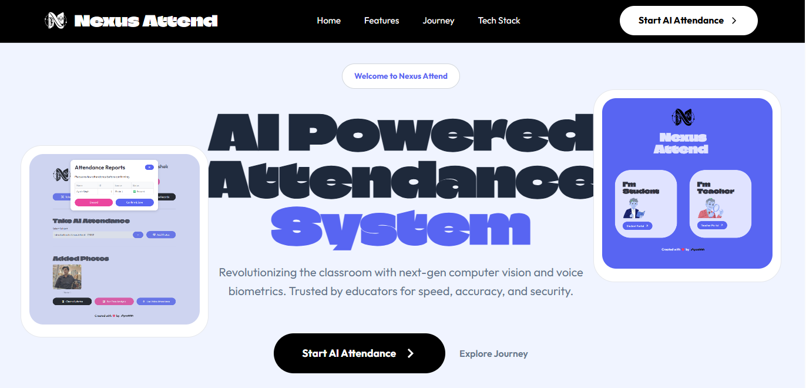

# Nexus Attend

> **Attendance, reimagined.**  
> An AI-powered classroom attendance experience built around computer vision, voice biometrics, and a polished teacher workflow.

<p align="center">
  
</p>

<p align="center">
  <strong>Fast. Accurate. Future-ready.</strong><br>
  A premium landing page for an intelligent attendance platform.
</p>

<p align="center">
  <a href="https://nexus-attend.streamlit.app/">Launch AI Attendance</a>
  ·
  <a href="http://127.0.0.1:5002/">Run locally</a>
</p>

## Live preview

The screenshot below was captured from the locally served live page:



## What is Nexus Attend?

Nexus Attend is a modern attendance platform concept for educators who want less manual administration and more reliable classroom data. Its experience combines a bold, responsive marketing page with a clear path from teacher login to actionable attendance records.

### Core capabilities

- **AI face analysis** — identify students from a single classroom photo.
- **Sequential voice ID** — validate attendance through voice biometrics.
- **QR-driven rosters** — make enrollment quick with course-specific QR codes.
- **Teacher-first workflow** — move from secure login to course setup, attendance, and reporting.
- **Actionable records** — review confidence scores, historical logs, and downloadable reports.
- **Responsive visual system** — expressive typography, high-contrast surfaces, and scroll-reveal interactions.

## The teacher journey

| Step | Experience |
| --- | --- |
| 01 | Secure login |
| 02 | Interactive dashboard |
| 03 | Course management |
| 04 | FaceID attendance |
| 05 | Voice ID attendance |
| 06 | Actionable attendance records |

## Tech stack

| Layer | Technology |
| --- | --- |
| Web server | Python + Flask |
| UI | HTML5, CSS3, vanilla JavaScript |
| Typography | Google Fonts — Climate Crisis and Outfit |
| Visual assets | PNG product-flow mockups and brand artwork |
| Production server | Gunicorn |

## Run locally

### 1. Clone the repository

```bash
git clone https://github.com/Ayush-0915/Nexus-Attend-Website.git
cd Nexus-Attend-Website
```

### 2. Create and activate a virtual environment

**Windows PowerShell**

```powershell
python -m venv .venv
.\.venv\Scripts\Activate.ps1
```

**macOS / Linux**

```bash
python3 -m venv .venv
source .venv/bin/activate
```

### 3. Install dependencies

```bash
pip install -r requirements.txt
```

### 4. Start the development server

```bash
python app.py
```

Open [http://127.0.0.1:5002](http://127.0.0.1:5002) in your browser.

## Project structure

```text
.
├── app.py                         # Flask application entry point
├── templates/
│   └── index.html                 # Landing page markup
├── static/
│   ├── css/style.css              # Visual system and responsive layout
│   ├── js/script.js               # Scroll-reveal interactions
│   └── img/
│       ├── demo/                  # Product-flow screenshots
│       └── nexus-attend-live.png  # Live page README capture
└── requirements.txt               # Python dependencies
```

## Deployment

For a production WSGI server:

```bash
gunicorn app:app
```

The main call-to-action links to the live AI attendance experience at [nexus-attend.streamlit.app](https://nexus-attend.streamlit.app/).

## Design direction

Nexus Attend uses a deliberate editorial style: oversized display type creates confidence, electric blue signals intelligence, and black-and-white navigation keeps the product story focused. The page is intentionally visual so educators can understand the workflow before they ever open the attendance tool.

## License

This project is maintained as a personal product and portfolio experience. Add a project-specific license before redistributing it.
